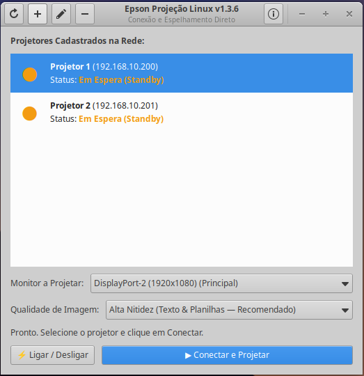

## O Problema: Projetores Corporativos Epson no Linux

Quem trabalha em ambiente Linux (Debian, Ubuntu, Pop!\_OS, Mint, Fedora) e precisa projetar a tela pela rede em projetores corporativos da Epson logo esbarra num muro: o software oficial (*EasyMP Network Projection* / *iProjection*) não tem suporte nativo moderno para Linux.

Tentar rodar o executável de Windows via **Wine** quase sempre falha porque o instalador depende de drivers virtuais de vídeo do Windows e chamadas de rede proprietárias que quebram durante o handshake ou travam a interface gráfica.

Como a Epson não publica a especificação do protocolo de streaming **EasyMP**, decidi abrir o capô utilizando **Engenharia Reversa (REA)** — dissecando o tráfego TCP/IP entre o cliente oficial e o projetor e analisando as rotinas binárias da biblioteca `EMP_PJCON.dll` — para construir um cliente **100% nativo em Python + GTK 3**, leve e sem dependências proprietárias: o [**epson-projector-linux**](https://github.com/maxxcleiton/epson-projector-linux){:target="_blank"}.

---

## Arquitetura Descoberta na Engenharia Reversa

Ao inspecionar a comunicação de rede e o binário original, ficou claro que o firmware do projetor opera em **três portas TCP distintas**, cada uma com um papel bem definido:

```text
+--------------------------------------------------------------------+
|                       Computador Linux                             |
|                                                                    |
|  [ Interface GTK 3 ] <---> [ Captura de Tela + Mouse (XFixes) ]    |
+-----------+----------------------+--------------------+------------+
            |                      |                    |
   TCP 3629 |             TCP 3620 |           TCP 3621 |
(ESC/VP.net)|         (EasyMP Ctrl)|     (EasyMP Stream)|
            v                      v                    v
+--------------------------------------------------------------------+
|                        Projetor Epson                              |
|                                                                    |
|  - Liga/Desliga           - Handshake          - Decodificador     |
|  - Leitura de Status      - Resolução            JPEG Hardware     |
|  - Horas de Lâmpada       - Takeover           - Buffer de Frame   |
+--------------------------------------------------------------------+
```

### 1. Controle de Hardware via `ESC/VP.net` (Porta TCP 3629)

Antes mesmo de transmitir vídeo, precisamos saber se o projetor está em Standby, aquecendo ou ligado, além de comutar a entrada para **LAN** (`SOURCE 53`) e zerar o volume de hardware para evitar ruídos.

O protocolo na porta `3629` exige um handshake inicial binário de 16 bytes seguido por comandos ASCII terminados em `\r`:

```python
ESCVP_PORT = 3629
HANDSHAKE_REQUEST = b"ESC/VP.net\x10\x03\x00\x00\x00\x00"
HANDSHAKE_ACK = b"ESC/VP.net"
```

Depois que o projetor responde com o ACK, podemos consultar o estado da lâmpada (`PWR?`), ligar remotamente (`PWR ON`) e aguardar o ciclo de *warm-up* antes de abrir a sessão de vídeo.

### 2. Handshake de Sessão e Takeover no `EasyMP Control` (Porta TCP 3620)

Na porta `3620`, todos os pacotes começam com a assinatura mágica `EEMP0100`, seguida pelos 4 bytes do IP local, código do comando (`uint32` little-endian) e tamanho do payload:

- `0x0002`: Probe rápido (retorna informações do projetor, incluindo os 6 bytes do MAC address nos offsets `68..74` e a flag se o projetor já está ocupado por outro computador).
- `0x0004`: Requisição de início de sessão (`REQCONNECT`), que o projetor responde com `0x0005` ao aceitar.
- `0x000a`: Pacote de *keep-alive* enviado a cada 1 segundo para manter a sessão viva.
- `0x0006` / `0x0007`: Notificação de encerramento ou *takeover* (quando outro colega assume a projeção na sala).

### 3. O Segredo do Streaming de Vídeo na Porta TCP 3621: Tight JPEG (`0x90`) e os 4 Quadrantes

A parte mais interessante da engenharia reversa na `EMP_PJCON.dll` foi entender como o decodificador de hardware do projetor recebe os frames de vídeo na porta `3621`.

Em vez de receber um único JPEG da tela inteira, o projetor utiliza uma variante do protocolo **Tight JPEG (encoding `7`, byte de controle `0x90`)** precedida por um descritor binário de 16 bytes onde o tamanho do buffer é codificado em 3 bytes compactos (*variable-length integer* de 7 bits por byte com MSB de continuação):

```python
def make_tight_jpeg_desc(tx: int, ty: int, tw: int, th: int, data_len: int) -> bytes:
    """
    Descritor Tight JPEG nativo de 16 bytes (extraído de EMP_PJCON.dll / modo 0):
    - 0..7:   x, y, w, h (>HHHH)
    - 8..11:  encoding 7 (>I)
    - 12:     0x90 (JPEG control byte)
    - 13..15: 3 bytes de tamanho compacto Tight
    """
    b0 = (data_len & 0x7F) | 0x80
    b1 = ((data_len >> 7) & 0x7F) | 0x80
    b2 = (data_len >> 14) & 0xFF
    return struct.pack(">HHHH", tx, ty, tw, th) + struct.pack(">I", 7) + bytes([0x90, b0, b1, b2])
```

Além disso, o hardware divide o canvas (`1024x768`) em **4 quadrantes (`512x384`)** e possui uma peculiaridade crítica: **o projetor só atualiza a imagem na parede quando recebe o quadrante `(0, 0)` (Top-Left)**. Se você enviar o quadrante `(0, 0)` primeiro, a imagem fica rasgada (*tearing*). A solução foi ordenar o envio deixando o `(0, 0)` sempre por último como gatilho de *flush* de hardware:

```python
QUADRANTS = [
    (HALF_W, 0,      HALF_W, HALF_H, (HALF_W, 0,      CANVAS_W, HALF_H)),   # 1º Top-Right
    (0,      HALF_H, HALF_W, HALF_H, (0,      HALF_H, HALF_W,   CANVAS_H)), # 2º Bot-Left
    (HALF_W, HALF_H, HALF_W, HALF_H, (HALF_W, HALF_H, CANVAS_W, CANVAS_H)), # 3º Bot-Right
    (0,      0,      HALF_W, HALF_H, (0,      0,      HALF_W,   HALF_H)),   # 4º Top-Left ← GATILHO
]
```

---

## Desafios Reais Resolvidos no Linux

Construir o protocolo foi metade do caminho; a outra metade foi deixar a experiência de uso sólida no dia a dia:

1. **Captura do Cursor do Mouse em 64-bits (`libXfixes` LP64):**
   Capturas de tela padrão via Gdk/Pillow não incluem o ponteiro do mouse. Integrei chamadas diretas à `libXfixes.so.3` via `ctypes` (`XFixesGetCursorImage`). Em sistemas Linux `x86_64` (modelo LP64), o array `pixels` retornado pelo X11 usa `unsigned long` de **8 bytes por pixel**, onde apenas os 4 bytes inferiores contêm o ARGB. Ajustar esse *stride* em memória eliminou o efeito "serrilhado" no ponteiro.
2. **Pipeline Desacoplado Zero-Lag:**
   A captura de tela e o socket TCP rodam em threads separadas ligadas por uma fila não-bloqueante de 1 slot. Se a rede Wi-Fi oscilar por alguns milissegundos, o frame antigo é descartado imediatamente em favor do frame mais recente, mantendo o mouse em tempo real sem atraso acumulado.
3. **Histerese de Status e Janela de Boot Frio de 90s:**
   Quando o projetor sai do Standby, a placa de rede interna dele reinicia enquanto a lâmpada aquece. Implementei uma máquina de estados com histerese por sequência (*pending streak*) que aguarda leituras consecutivas antes de mudar o status na UI, evitando que a tela pisque como "Desconectado" durante a ignição da lâmpada.
4. **Detecção Real dos Monitores via EDID:**
   Para quem usa múltiplos monitores no notebook, o app lê os blocos binários **EDID** do `xrandr --verbose` e mostra o nome real do fabricante/modelo (ex: `AOC 2369M`, `Acer V226HQL`) na hora de escolher qual tela transmitir.

> **Dica de Rede (Canais Wi-Fi 12 e 13):** Muitos dongles wireless da Epson (*ELPAP07* / *ELPAP10*) vêm com firmware travado na região `US1` (canais 1 a 11). No Brasil, roteadores no automático costumam cair nos canais **12 ou 13**, fazendo o projetor "sumir" do Wi-Fi. Fixar o AP nos canais **1, 6 ou 11** resolve na hora.

---

## Como Instalar e Usar no Linux

Você pode baixar o pacote `.deb` pronto na [página de Releases do GitHub](https://github.com/maxxcleiton/epson-projector-linux/releases){:target="_blank"} ou gerar o pacote direto do código-fonte:

```bash
git clone https://github.com/maxxcleiton/epson-projector-linux.git
cd epson-projector-linux
chmod +x build_deb.sh
./build_deb.sh
sudo dpkg -i epson-projector-linux_*_all.deb
sudo apt-get install -f
```

O pacote já cria o executável `/usr/bin/epson-projector` e o atalho no menu de aplicativos do sistema.

- **Repositório completo e código-fonte:** [github.com/maxxcleiton/epson-projector-linux](https://github.com/maxxcleiton/epson-projector-linux){:target="_blank"}
