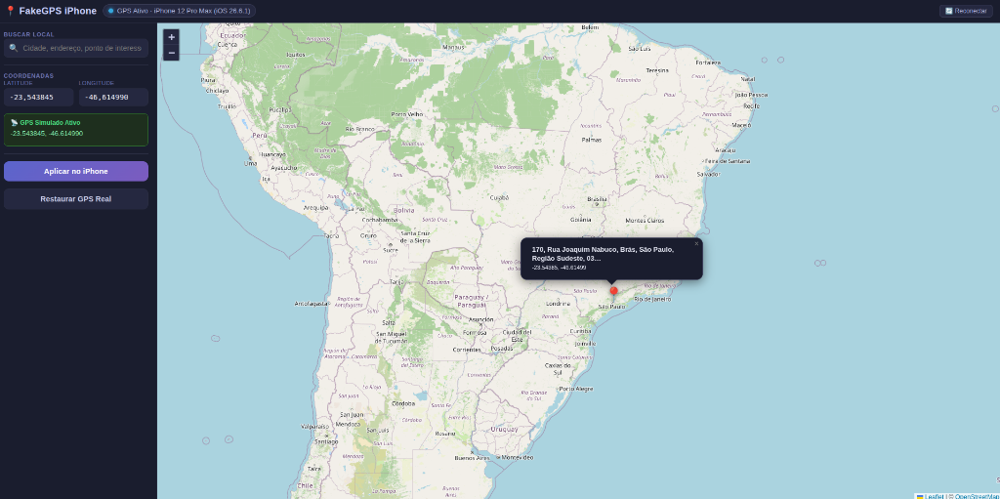

## O Cenário: Testar Geolocalização no iOS sem Ficar Preso ao Xcode

Desenvolvedores e analistas de QA que precisam testar funcionalidades baseadas em GPS no iPhone sempre enfrentaram duas limitações chatas:
1. Fora do macOS (no **Linux** ou **Windows**), não existe o Xcode para simular coordenadas num aparelho físico via USB. Softwares comerciais que fazem isso costumam ser pagos, fechados ou cheios de *bloatware*.
2. Mesmo no **macOS**, alterar a localização pelo Xcode exige abrir menus de *Custom Location* e digitar latitude e longitude na mão toda vez, sem um mapa interativo ou busca rápida de rua/cidade.

Para resolver isso de forma limpa, criei o [**FakeGPS iPhone Web**](https://github.com/maxxcleiton/fakegps-iphone-web){:target="_blank"}: um servidor leve em Python (**FastAPI** + **pymobiledevice3**) com mapa interativo em tema escuro (**Leaflet** + **OpenStreetMap/Nominatim**) que roda no **Linux, Windows e macOS**, alterando o GPS do iPhone físico via cabo USB **sem Jailbreak e sem precisar de `sudo`/root**.

---

## Como o iOS Aceita Coordenadas Simuladas Sem Jailbreak?

O iOS possui um subsistema oficial de instrumentação voltado para desenvolvimento chamado **DVT (`com.apple.instruments.remoteserver`)**, que só fica acessível após ativar o **Modo Desenvolvedor** no aparelho (*Ajustes → Privacidade e Segurança → Modo Desenvolvedor*) e parear a confiança USB (*Confiar neste Computador*).

Dentro do barramento DVT existe o canal de serviço **`LocationSimulation`**, que instrui o daemon interno `locationd` do iOS a sobrescrever as leituras do chip GPS físico pelas coordenadas enviadas pelo computador pareado.

### A Virada de Arquitetura no iOS 17+: De `Lockdown` para `RemoteXPC` (`RSD`)

Na investigação dos protocolos de comunicação USB da Apple para garantir suporte desde o **iOS 12 até o iOS 17, 18 e 26+**, o ponto mais crítico foi a mudança radical introduzida pela Apple a partir do iOS 17:

- **No iOS 12 ao 16:** O serviço DVT é exposto diretamente sobre o daemon `lockdownd` via `usbmuxd`. Basta abrir a conexão USB tradicional e instanciar o `DvtProvider`.
- **No iOS 17 em diante:** A Apple migrou os serviços de desenvolvedor para uma nova pilha chamada **RemoteXPC** sobre túneis IPv6 com **Remote Service Discovery (`RSD`)**. Sem estabelecer esse túnel antes, qualquer tentativa de chamar o canal de localização falha silenciosamente ou retorna erro de serviço inexistente.

Para evitar exigir privilégios de administrador (`root` / `sudo`) para criar interfaces de rede TUN/TAP virtuais no sistema operacional, implementei a negociação direta via **túnel em *userspace* (`establish_userspace_rsd`)**, selecionando automaticamente o protocolo correto de acordo com a versão do iOS detectada no handshake USB:

```python
major = int(self.ios_version.split(".")[0]) if self.ios_version else 17

if major >= 17:
    # iOS 17+: Túnel RemoteXPC / RSD inteiramente em userspace (sem precisar de sudo/root)
    rsd = await userspace_tunnel.establish_userspace_rsd(serial=self.serial)
    dvt = await new_stack.enter_async_context(DvtProvider(rsd))
else:
    # iOS 12 a 16: Canal DVT direto sobre usbmuxd / lockdownd
    ld = await create_using_usbmux(serial=self.serial)
    dvt = await new_stack.enter_async_context(DvtProvider(ld))

loc_sim = await new_stack.enter_async_context(LocationSimulation(dvt))
```

---

## O Problema do "GPS que Volta Sozinho" no iOS (e Como Resolver)

Quem já tentou enviar uma coordenada avulsa para o serviço `LocationSimulation` via linha de comando percebe um comportamento curioso nas versões recentes do iOS: **poucos segundos depois de definir a posição, o iPhone descarta a coordenada simulada e volta para o GPS real**.

Isso acontece por dois motivos internos do iOS:
1. Se o contexto do canal `DvtProvider` / `LocationSimulation` for fechado após o envio do pacote, o `locationd` interpreta que a sessão de depuração terminou.
2. Mesmo com o socket aberto, o iOS possui um *watchdog* de sessão que pode expirar a coordenada estática se não houver atividade periódica no canal.

A solução no **FakeGPS iPhone** foi combinar dois mecanismos no `server.py`:
- Manter a pilha de contexto assíncrono aberta em memória usando `AsyncExitStack` protegida por `asyncio.Lock()`.
- Rodar uma *background task* assíncrona (`keep_alive_loop`) que reenvia o pulso da coordenada ativa a cada **2 segundos** enquanto a simulação estiver ativa:

```python
async def keep_alive_loop():
    """Reenvia periodicamente a coordenada para manter o GPS fixo no iOS."""
    while True:
        try:
            await manager.refresh_location()
        except Exception as e:
            log.debug("Erro no loop de keep-alive: %s", e)
        await asyncio.sleep(manager.refresh_interval)
```

Quando o usuário clica em **"Restaurar GPS Real"** (ou fecha o servidor pelo botão **"⏹ Desligar"** da interface web), o gerenciador envia o comando explícito `loc_sim.clear()` e desmonta o `AsyncExitStack` de forma limpa, devolvendo o controle ao GPS físico do aparelho na hora.

---

## Bônus no macOS: Integração Automática com o Simulador do Xcode

Além de iPhones físicos na USB, adicionei detecção automática do **iOS Simulator** no macOS. Se não houver um iPhone espetado na USB, o backend consulta `xcrun simctl list devices booted`, identifica o UDID do simulador aberto e injeta as coordenadas diretamente via `xcrun simctl location <UDID> set <lat>,<lng>`, permitindo controlar o simulador da Apple clicando no mesmo mapa web.

---

## Como Instalar e Usar

### No Linux (Debian, Ubuntu, Pop!\_OS, Mint)
Você pode baixar o pacote `.deb` na [aba Releases](https://github.com/maxxcleiton/fakegps-iphone-web/releases){:target="_blank"} ou rodar direto do repositório:

```bash
git clone https://github.com/maxxcleiton/fakegps-iphone-web.git
cd fakegps-iphone-web
./start.sh
```

Para gerar e instalar o pacote `.deb` localmente:

```bash
./build-deb.sh
sudo apt install ./fakegps-iphone_*_all.deb
```

### No Windows e macOS
- **Windows:** Basta ter os drivers USB da Apple (iTunes ou app *Dispositivos Apple*) e executar o `FakeGPS-iPhone.exe` disponível nas [Releases](https://github.com/maxxcleiton/fakegps-iphone-web/releases){:target="_blank"}.
- **macOS:** Extraia o `FakeGPS-iPhone-macOS.zip` e abra o aplicativo **`FakeGPS iPhone.app`** ou rode `./start-mac.sh`.

O painel abre automaticamente em `http://localhost:8765`. Basta clicar em qualquer ponto do mapa (ou pesquisar um endereço) e clicar em **Aplicar Localização**.

- **Repositório completo e código-fonte:** [github.com/maxxcleiton/fakegps-iphone-web](https://github.com/maxxcleiton/fakegps-iphone-web){:target="_blank"}
